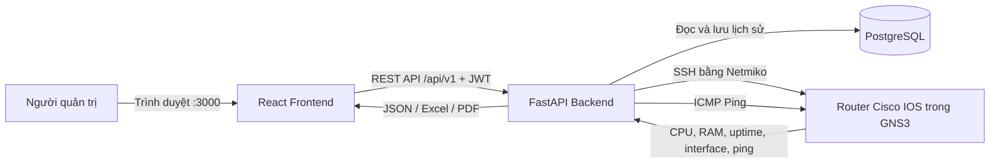

# Network Health Check

Hệ thống kiểm tra sức khỏe router Cisco IOS trong GNS3 bằng Python, Netmiko,
FastAPI, PostgreSQL, React và Docker. Hệ thống thu thập CPU, RAM, uptime,
interface, packet loss và latency, sau đó đánh giá thành `Healthy`, `Warning`
hoặc `Critical`.

## Cách hệ thống hoạt động

### Kiến trúc tổng thể



Ba dịch vụ `frontend`, `backend` và `db` chạy bằng Docker Compose trên Ubuntu
VM. Frontend chuyển mọi yêu cầu `/api` vào backend trong mạng Docker nội bộ.
Backend là thành phần duy nhất kết nối trực tiếp tới PostgreSQL và router GNS3.

### Luồng đăng nhập và quản lý thiết bị

1. Người dùng đăng nhập trên React; FastAPI xác thực tài khoản và trả về access
   token.
2. Frontend gửi token theo dạng `Authorization: Bearer ...` trong các API cần
   bảo vệ.
3. Khi thêm router, backend kiểm tra địa chỉ IP có thuộc dải mạng lab cho phép
   hay không.
4. Mật khẩu SSH và enable secret được mã hóa bằng Fernet trước khi lưu vào
   PostgreSQL. Mật khẩu quản trị web được băm bằng PBKDF2-SHA256.
5. Nút **Thử SSH** mở một kết nối thử và trả về kết quả mà không tạo lịch sử
   health check.

### Luồng chạy health check

Khi bấm **Quét tất cả thiết bị**, hệ thống xử lý theo thứ tự sau:

1. Frontend gọi `POST /api/v1/checks/run-all`.
2. Backend tạo một `scan_run` và một bản ghi `health_check` cho mỗi thiết bị
   đang được kích hoạt. Hệ thống không cho chạy hai đợt quét toàn bộ cùng lúc.
3. `ThreadPoolExecutor` kiểm tra nhiều router song song. Số luồng được lấy từ
   mục **Số thiết bị kiểm tra đồng thời** trong trang Cấu hình.
4. Với từng router, backend ping IP quản trị từ Ubuntu VM rồi dùng Netmiko mở
   SSH tới Cisco IOS.
5. Backend chạy các lệnh sau và phân tích kết quả:

   | Dữ liệu | Lệnh/nguồn thu thập |
   |---|---|
   | Uptime | `show version \| include uptime` |
   | CPU 5 phút | `show processes cpu \| include CPU utilization` |
   | RAM | `show memory statistics \| include Processor` |
   | Trạng thái interface | `show ip interface brief` |
   | Lỗi/CRC/drop từng cổng | `show interfaces <tên-interface>` |
   | Loss và latency đường truyền | `ping <target> repeat 10 timeout 1` trên router |
   | Khả năng tới router | Lệnh `ping` từ container backend |

6. Bộ đánh giá so sánh CPU, RAM, packet loss và latency với ngưỡng cấu hình;
   đồng thời kiểm tra SSH, trạng thái cổng và bộ đếm lỗi.
7. Mức nghiêm trọng nhất trong các phát hiện trở thành trạng thái tổng hợp:
   `Healthy < Warning < Critical`.
8. Kết quả được lưu vào PostgreSQL gồm thông số chính, interface, kết quả ping,
   cảnh báo và thời gian thực hiện.
9. Trong lúc quét, frontend gọi `GET /api/v1/scan-runs/{id}` mỗi 2 giây. Khi
   hoàn tất, Dashboard và danh sách thiết bị tự tải lại dữ liệu mới.

> `execution_status` cho biết tác vụ đang chạy, thành công hay lỗi kỹ thuật;
> `overall_status` cho biết sức khỏe của router. Vì vậy một lần quét có thể chạy
> thành công nhưng router vẫn có trạng thái `Critical`, ví dụ khi SSH thất bại.

### Quét thủ công, quét tự động và báo cáo

- **Kiểm tra ngay:** chỉ quét router đang xem và lưu một bản ghi lịch sử mới.
- **Quét tất cả:** kiểm tra song song toàn bộ thiết bị đang kích hoạt.
- **Quét tự động:** APScheduler gọi cùng luồng quét theo chu kỳ cấu hình khi
  `SCHEDULER_ENABLED=true`.
- **Dashboard:** lấy lần kiểm tra gần nhất của từng thiết bị để tính số lượng
  Tốt, Cảnh báo và Nghiêm trọng.
- **Chi tiết thiết bị:** hiển thị biểu đồ xu hướng, interface, ping, cảnh báo và
  lịch sử các lần kiểm tra.
- **Báo cáo:** truy vấn dữ liệu đã lưu theo thời gian/trạng thái rồi xuất Excel
  hoặc PDF; việc xuất báo cáo không cần kết nối lại router.

### Khi router mất kết nối

Nếu SSH thất bại, collector vẫn tạo kết quả `Critical`, lưu nội dung lỗi và giữ
lại số liệu ping quản trị nếu có. Lỗi ping được phân loại theo loại phép đo và
ngưỡng trong Cấu hình. Nhờ vậy lỗi của R4 Demo vẫn xuất hiện trên Dashboard,
lịch sử và báo cáo thay vì làm hỏng toàn bộ đợt quét.

## Mô hình demo đã chuẩn bị

| Thiết bị | IP | Vai trò | Kết quả mong đợi |
|---|---|---|---|
| R1 | `192.168.141.11` | Router thật trong GNS3 | Kết nối SSH thành công |
| R2 | `192.168.141.12` | Router thật trong GNS3 | Kết nối SSH thành công |
| R3 | `192.168.141.13` | Router thật trong GNS3 | Kết nối SSH thành công |
| R4 - Mất kết nối (Demo) | `192.168.141.14` | Thiết bị giả, không có router thật | `Critical`, SSH thất bại |

- Project GNS3: `Network_Health_Check`
- Ubuntu VM chạy Docker: `192.168.141.128`
- Trang web: `http://192.168.141.128:3000`
- Tài khoản web demo: `admin / qtm`
- Tài khoản SSH router trong lab: `admin / qtm`

> Các tài khoản trên chỉ dùng cho môi trường lab, không dùng trong hệ thống thật.

## Cấu hình Settings khuyến nghị khi demo

Mở trang **Cấu hình** và đặt:

| Thông số | Cảnh báo | Nghiêm trọng |
|---|---:|---:|
| CPU | 70% | 90% |
| RAM | 75% | 90% |
| Packet loss | 10% | 30% |
| Latency | 50 ms | 150 ms |

- Chu kỳ tự động: `15 phút`.
- Số thiết bị kiểm tra đồng thời: `3`.
- Khi thuyết trình nên đặt `SCHEDULER_ENABLED=false` trong `.env` để chủ động
  bấm **Quét tất cả**. Nếu muốn trình diễn quét tự động thì đặt thành `true`.

## Checklist trước buổi demo

1. Bật Ubuntu VM và chờ Ubuntu khởi động hoàn tất.
2. Mở GNS3 trên Windows.
3. Mở project `Network_Health_Check`.
4. Bấm **Start All Nodes** và chờ khoảng 30 giây.
5. Kiểm tra Docker trên Ubuntu:

   ```bash
   cd ~/QTM
   docker compose ps
   ```

6. Nếu container chưa chạy:

   ```bash
   cd ~/QTM
   docker compose up -d
   ```

7. Mở `http://192.168.141.128:3000` và đăng nhập `admin / qtm`.
8. Bấm **Quét tất cả**.

Kết quả đúng là R1–R3 kết nối thành công và R4 Demo báo mất kết nối. Nhờ đó
Dashboard luôn có cả trường hợp tốt và nghiêm trọng để trình bày.

## Kịch bản thuyết trình đề xuất

1. Mở **Tổng quan**, giới thiệu số lượng thiết bị theo trạng thái.
2. Bấm **Quét tất cả** để chạy kiểm tra trực tiếp.
3. Mở R1 để trình bày CPU, RAM, uptime, interface, packet loss và latency.
4. Mở R4 Demo để trình bày khả năng phát hiện thiết bị mất kết nối.
5. Mở **Báo cáo**, lọc theo thời gian/trạng thái rồi xuất Excel (.xlsx) hoặc PDF.
6. Mở **Cấu hình** để giải thích cách thay đổi các ngưỡng đánh giá.

## Khôi phục SSH khi router báo mất kết nối

Nếu R1, R2 hoặc R3 ping được nhưng SSH thất bại, mở console của router đó và
chạy:

```cisco
enable
configure terminal
ip domain-name qtm.local
username admin privilege 15 secret qtm
enable secret qtm
crypto key generate rsa modulus 1024
ip ssh version 2
line vty 0 4
login local
transport input ssh
end
write memory
```

Sau đó quay lại web và bấm **Thử SSH**. Nếu trình duyệt vẫn hiển thị giao diện
cũ, nhấn `Ctrl + F5`.

## Lệnh kiểm tra nhanh

Trên Ubuntu VM:

```bash
ping -c 2 192.168.141.11
ping -c 2 192.168.141.12
ping -c 2 192.168.141.13
docker compose -f ~/QTM/docker-compose.yml ps
```

## Lưu ý để demo ổn định

- Không tạo router thật sử dụng IP `192.168.141.14` vì đây là IP lỗi demo.
- Không xóa thiết bị R4 Demo khỏi trang Thiết bị.
- Luôn dùng đúng project GNS3 `Network_Health_Check`.
- Sau khi sửa cấu hình router phải chạy `write memory`.
- Không xóa Docker volume `qtm_postgres_data`, vì volume chứa dữ liệu và lịch sử.
- Nên chạy thử toàn bộ checklist ít nhất một lần trước buổi báo cáo.

## Tài liệu

- [Kế hoạch triển khai 15 tuần](plans/network-health-check-blueprint.md)
- [Cấu hình GNS3 lab](docs/gns3-lab.md)
- [Hướng dẫn backend](backend/README.md)
- [Hướng dẫn frontend](frontend/README.md)
